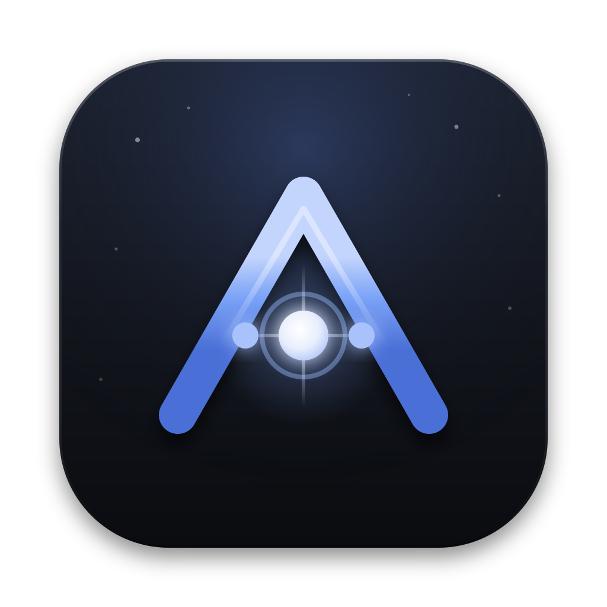
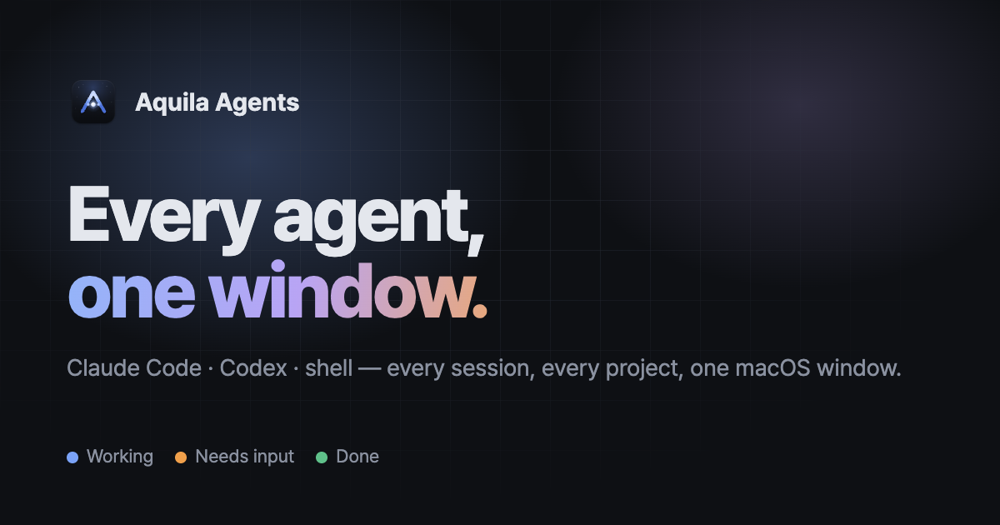
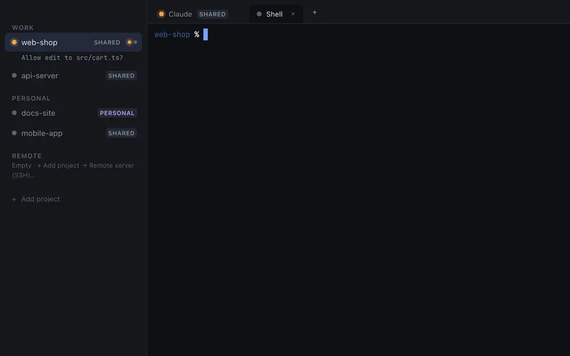

<div align="center">



# Aquila Agents

**Every Claude Code and Codex session, in one window.**

**English** · [한국어](docs/ko/README.md)

[Website](https://kwangyoulsagong.github.io/aquila-agents/en/) ·
[Docs](https://kwangyoulsagong.github.io/aquila-agents/en/docs/) ·
[Download for macOS](https://github.com/kwangyoulsagong/aquila-agents/releases/latest)

[](https://github.com/kwangyoulsagong/aquila-agents/releases/latest)




</div>

Stop juggling a terminal per project. Pick a project on the left, open Claude, Codex or a shell as tabs, and see at a
glance which agent is **working**, **done**, or **waiting for you**.



## Why

- **The real CLIs, embedded.** Aquila runs your own `claude` and `codex` in a real terminal — same login, same
  `CLAUDE.md`, hooks, MCP, slash commands, same token usage. Nothing is reimplemented.
- **Status you can see.** Working / needs input / error / done, per session and per project. <kbd>⌘J</kbd> jumps to
  the session that has waited longest; macOS notifications and a Dock badge bring you back.
- **Work side by side.** Split into up to four panes, open sessions in git worktrees, review the agent's diff with
  line comments, run your dev server next to it.
- **Notes next to code.** The Markdown in your repos becomes a graph and a block editor, with agent edits shown as
  diffs you can revert.
- **Your setup stays yours.** Hooks attach only to sessions Aquila starts (`--settings`); it never writes to
  `~/.claude`, `~/.codex` or your shell rc files.
- **Korean & English** UI.

## Install

1. Download `Aquila.Agents-<version>-arm64.dmg` from the
   [latest release](https://github.com/kwangyoulsagong/aquila-agents/releases/latest) (Apple Silicon).
2. Open it and drag **Aquila Agents** to Applications.
3. Builds aren't signed yet: the first launch is blocked. Right-click the app → **Open** → **Open**, or run once:
   ```sh
   xattr -dr com.apple.quarantine "/Applications/Aquila Agents.app"
   ```

You need `claude` and/or `codex` installed and logged in — Aquila runs the real CLIs.
→ [Full install guide](https://kwangyoulsagong.github.io/aquila-agents/en/docs/start/install/) ·
[Quick tour](https://kwangyoulsagong.github.io/aquila-agents/en/docs/start/quick-tour/)

## Shortcuts

| Keys              | Action                                                                         |
| ----------------- | ------------------------------------------------------------------------------ |
| ⌘T / ⇧⌘T / ⌥⌘T    | Open Claude / Codex / shell in the current project                             |
| ⌘W                | Close session (empty pane: close the pane)                                     |
| ⌘D / ⇧⌘D          | Split right / down (up to 4 panes)                                             |
| ⌥⌘←→↑↓            | Move focus between panes                                                       |
| ⇧⌘↩               | Zoom the focused pane / restore (or double-click its head)                     |
| ⌥⇧⌘←→↑↓           | Resize panes (or drag the divider; double-click evens it out)                  |
| ⇧⌘G               | Show / hide the changes panel (git diff)                                       |
| ⌘K                | Command palette: jump to a session or project, or run an action                |
| ⌘J                | Next session that needs you (waiting > error > done, any project)              |
| Right-click **+** | New Claude / Codex / shell, or **Open in worktree…** (`../<repo>-wt/<branch>`) |
| ⌘1–9              | Jump to project                                                                |

[All shortcuts →](https://kwangyoulsagong.github.io/aquila-agents/en/docs/reference/shortcuts/)

## Development

```bash
npm install     # also rebuilds node-pty for Electron
npm run dev     # app with hot reload
npm run check   # typecheck + lint (incl. FSD boundaries) + tests — must pass
npm run smoke   # build, launch, verify a terminal session works, screenshot → dist/smoke.png
npm run capture # rebuild the in-app guide's screenshots and loops from demo fixtures (ko + en)
npm run dist    # package → release/Aquila Agents-<version>-arm64.dmg (+ .zip)
```

Projects live in `~/.aquila/config.json` (created on first run; "Open settings file" in the sidebar).
Read [AGENTS.md](AGENTS.md) for the rules every contributor (human or agent) follows, and
[Contributing](https://kwangyoulsagong.github.io/aquila-agents/en/docs/contributing/development/) for the walkthrough.

<details>
<summary><b>Publishing a release</b></summary>

Bump `version` in `package.json` and write its release notes first: `npm run release-notes -- draft` drafts
`release-notes/<version>.json` from the commits since the last tag; finish it in ko + en (3–5 headlines — 1–5 for a
patch release x.y.z with z > 0 — each a guide item). `npm run dist` refuses to package while it's missing or has a
TODO. Upload the `.dmg`, `.zip` and `latest-mac.yml` to a GitHub release tagged `v<version>`: installed apps notify
about it. Then bump `VERSION` in `site/src/lib/links.ts` so the website's download buttons hand out the new build.

`npm run dist:win` also builds unsigned Windows installers (`AquilaAgents-<version>-{x64,arm64}-setup.exe` +
`latest.yml`); Windows isn't an officially supported platform yet.

</details>

## Docs

- User docs (ko / en): <https://kwangyoulsagong.github.io/aquila-agents/en/docs/> — source in [`site/`](site/README.md)
- [Architecture](docs/en/ARCHITECTURE.md) · [Design system](docs/en/DESIGN-SYSTEM.md) · [Tasks](docs/en/TASKS.md)
- Agents: [AGENTS.md](AGENTS.md) (Codex) / [CLAUDE.md](CLAUDE.md) (Claude Code)

---

<div align="center">
Made by <a href="https://github.com/kwangyoulsagong">Kwangyoul Sagong</a> ·
<a href="https://www.linkedin.com/in/%EA%B4%91%EC%97%B4-%EC%82%AC%EA%B3%B5-8626281b4">LinkedIn</a>
</div>
