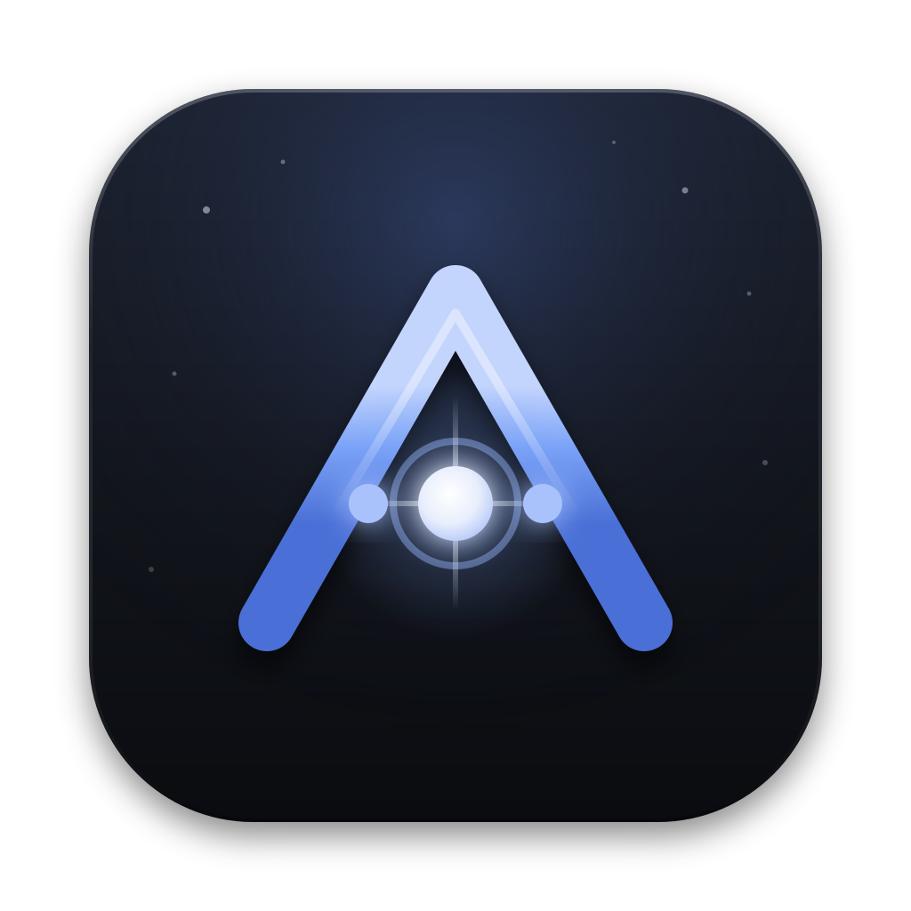
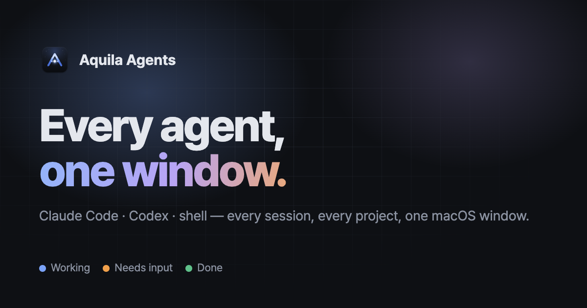
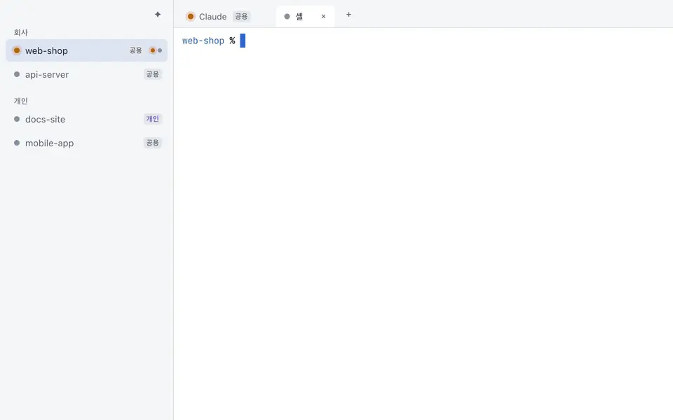

<div align="center">



# Aquila Agents

**모든 Claude Code · Codex 세션을, 한 창에서.**

[English](../../README.md) · **한국어**

[홈페이지](https://kwangyoulsagong.github.io/aquila-agents/ko/) ·
[문서](https://kwangyoulsagong.github.io/aquila-agents/ko/docs/) ·
[macOS용 다운로드](https://github.com/kwangyoulsagong/aquila-agents/releases/latest)

[](https://github.com/kwangyoulsagong/aquila-agents/releases/latest)




</div>

프로젝트마다 터미널을 옮겨 다니지 마세요. 왼쪽에서 프로젝트를 고르고 Claude / Codex / 셸을 탭으로 열면, 어떤 에이전트가
**작업 중**인지, **끝났는지**, **나를 기다리는지** 한눈에 보여요.



## 왜 Aquila인가요

- **진짜 CLI를 그대로.** 내 `claude`와 `codex`를 실제 터미널에서 실행해요. 로그인, `CLAUDE.md`, 훅, MCP, 슬래시 명령,
  토큰 사용량까지 그대로이고, 다시 만든 건 없어요.
- **보이는 상태.** 세션·프로젝트마다 작업 중 / 입력 필요 / 오류 / 완료. <kbd>⌘J</kbd>는 가장 오래 기다린 세션으로 바로
  가고, macOS 알림과 Dock 배지가 다시 불러 줘요.
- **나란히 일하기.** 최대 4개로 분할하고, git 워크트리에서 세션을 열고, 에이전트의 diff를 줄 코멘트로 리뷰하고, 옆에서
  dev 서버를 돌려요.
- **코드 옆의 노트.** 레포의 Markdown이 그래프와 블록 에디터가 되고, 에이전트가 고친 부분은 diff로 보고 되돌릴 수 있어요.
- **내 설정은 그대로.** 훅은 Aquila가 띄운 세션에만(`--settings`) 붙이고, `~/.claude`, `~/.codex`, 셸 설정 파일에는
  쓰지 않아요.
- **한국어·영어** UI.

## 설치

1. [최신 릴리스](https://github.com/kwangyoulsagong/aquila-agents/releases/latest)에서
   `Aquila.Agents-<버전>-arm64.dmg`를 내려받아요(Apple Silicon).
2. 열어서 **Aquila Agents**를 응용 프로그램으로 끌어다 놓아요.
3. 아직 서명 전이라 첫 실행이 막혀요. 앱을 우클릭 → **열기** → **열기**, 또는 한 번만:
   ```sh
   xattr -dr com.apple.quarantine "/Applications/Aquila Agents.app"
   ```

`claude` 또는 `codex`가 설치·로그인되어 있어야 해요. Aquila는 실제 CLI를 실행해요.
→ [설치 가이드](https://kwangyoulsagong.github.io/aquila-agents/ko/docs/start/install/) ·
[빠른 둘러보기](https://kwangyoulsagong.github.io/aquila-agents/ko/docs/start/quick-tour/)

## 단축키

| 키             | 동작                                                                          |
| -------------- | ----------------------------------------------------------------------------- |
| ⌘T / ⇧⌘T / ⌥⌘T | 현재 프로젝트에서 Claude / Codex / 셸 열기                                    |
| ⌘W             | 세션 닫기 (빈 화면이면 분할 닫기)                                             |
| ⌘D / ⇧⌘D       | 오른쪽 / 아래로 분할 (최대 4개)                                               |
| ⌥⌘방향키       | 분할 화면 사이 포커스 이동                                                    |
| ⇧⌘↩            | 포커스된 분할 확대 / 되돌리기 (헤더 더블클릭도 됨)                            |
| ⌥⇧⌘방향키      | 분할 크기 조절 (구분선 드래그, 더블클릭하면 반반)                             |
| ⇧⌘G            | 변경사항 패널(git diff) 열기 / 닫기                                           |
| ⌘K             | 명령 팔레트: 세션·프로젝트로 이동하거나 동작 실행                             |
| ⌘J             | 나를 기다리는 다음 세션으로 (waiting > error > done, 모든 프로젝트)           |
| **+** 우클릭   | 새 Claude / Codex / 셸, 또는 **워크트리에서 열기…** (`../<repo>-wt/<branch>`) |
| ⌘1–9           | 프로젝트 이동                                                                 |

[모든 단축키 →](https://kwangyoulsagong.github.io/aquila-agents/ko/docs/reference/shortcuts/)

## 개발

```bash
npm install     # Electron용 node-pty 빌드까지
npm run dev     # 핫 리로드로 앱 실행
npm run check   # 타입 체크 + 린트(FSD 경계 포함) + 테스트 — 반드시 통과
npm run smoke   # 빌드 → 실행 → 터미널 세션 동작 확인 → 스크린샷 dist/smoke.png
npm run capture # 앱 가이드의 스크린샷·루프를 데모 픽스처로 다시 만들기 (ko + en)
npm run dist    # 패키징 → release/Aquila Agents-<버전>-arm64.dmg (+ .zip)
```

프로젝트 목록은 `~/.aquila/config.json`에 있어요(처음 실행 때 생성, 사이드바 "설정 파일 열기").
기여하는 사람(사람이든 에이전트든)이 따르는 규칙은 [AGENTS.md](../../AGENTS.md)에, 자세한 과정은
[기여하기](https://kwangyoulsagong.github.io/aquila-agents/ko/docs/contributing/development/)에 있어요.

<details>
<summary><b>릴리스 내보내기</b></summary>

`package.json`의 `version`을 올리고 릴리스 노트를 먼저 쓰세요: `npm run release-notes -- draft`가 지난 태그 이후
커밋으로 `release-notes/<버전>.json` 초안을 만들고, ko + en으로 마무리해요(헤드라인 3~5개, 패치 릴리스 x.y.z(z > 0)는
1~5개, 각각 가이드 항목). 노트가 없거나 TODO가 남아 있으면 `npm run dist`가 패키징을 거부해요. `.dmg`, `.zip`,
`latest-mac.yml`을 `v<버전>` 태그의 GitHub 릴리스에 올리면 설치된 앱이 알림을 띄워요. 그다음 `site/src/lib/links.ts`의
`VERSION`을 올려서 홈페이지 다운로드 버튼이 새 빌드를 주게 하세요.

`npm run dist:win`은 서명하지 않은 Windows 설치 파일(`AquilaAgents-<버전>-{x64,arm64}-setup.exe` + `latest.yml`)도
만들지만, Windows는 아직 공식 지원 플랫폼이 아니에요.

</details>

## 문서

- 사용자 문서(한/영): <https://kwangyoulsagong.github.io/aquila-agents/ko/docs/> — 소스는 [`site/`](../../site/README.md)
- [아키텍처](ARCHITECTURE.md) · [디자인 시스템](DESIGN-SYSTEM.md) · [태스크](TASKS.md)
- 에이전트용: [AGENTS.md](../../AGENTS.md) (Codex) / [CLAUDE.md](../../CLAUDE.md) (Claude Code)

---

<div align="center">
만든 사람 <a href="https://github.com/kwangyoulsagong">Kwangyoul Sagong</a> ·
<a href="https://www.linkedin.com/in/%EA%B4%91%EC%97%B4-%EC%82%AC%EA%B3%B5-8626281b4">LinkedIn</a>
</div>
